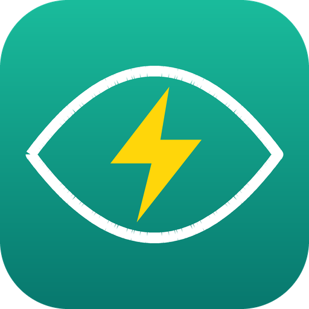

<p align="center"></p>

<h1 align="center">Watt Watcher</h1>

<p align="center">
A Home Assistant integration that turns a smart plug's power reading into an appliance cycle tracker:<br>
<b>washing machine, dishwasher, kettle, coffee maker</b> and anything else that draws power in phases.
</p>

<p align="center">
<a href="README.tr.md">Türkçe</a> ·
<a href="https://github.com/Korkuttum/watt_watcher/releases">Releases</a> ·
<a href="LICENSE">MIT</a>
</p>

---

## Features

- Works with **any power (W) sensor**. Fully local, no cloud.
- Define your own states: name, watt threshold, greater/less, icon. The first state is the **start**, the last one is the **finish**.
- **Pause-proof.** A dishwasher drops to 0 W for minutes between phases. If that counted as "finished",
  the next heating phase would announce a brand new start. Watt Watcher treats a wake-up shortly after
  "finished" as the **same cycle resuming** (`resumed`), not a new start.
- **Survives sensor drop-outs.** A momentary `unavailable` from the plug does not reset the state.
- **Survives restarts.** If Home Assistant restarts mid-cycle, the state is restored.
- Per appliance: power, status, cycle duration and cycle energy (Wh) sensors, plus an "active" binary sensor.
- Events for automations: `watt_watcher_started`, `_finished`, `_resumed`, `_idle`, `_state_changed`.
- Available in **English and Turkish**. Other languages fall back to English.

## Installation

### HACS
1. HACS → ⋮ → **Custom repositories** → `https://github.com/Korkuttum/watt_watcher` → category **Integration**.
2. Download **Watt Watcher** and restart Home Assistant.
3. Settings → Devices & services → **Add integration** → *Watt Watcher*.

### Manual
Download `watt_watcher.zip` from the latest [release](https://github.com/Korkuttum/watt_watcher/releases),
unpack it into `config/custom_components/watt_watcher/` and restart Home Assistant. Or copy the
`custom_components/watt_watcher` folder from this repository.

## Setup

1. Pick a name, the power sensor and the device type.
2. Edit the state names (one per line). The first one is the start state, the last one is the finish state.
3. For each state you get its own screen: watt threshold, icon, and (for in-between states) greater/less.
4. Set the timings. Resume window and scan interval are tucked into a collapsed **Advanced** section.

Afterwards, **Configure** on the integration card opens a menu: jump straight to **Timings**, or edit
**States and thresholds**. Renaming a state keeps its threshold and icon. **Reconfigure** changes the name
or the power sensor.

## Timings

| Setting | Meaning | Suggestion |
|---|---|---|
| **Start delay** (`active_delay`) | Power must stay above the threshold this long before a cycle starts | 60 s |
| **Finish delay** (`finished_delay`) | Power must stay low this long before the cycle finishes | washer 300 s, dishwasher 600 s |
| **Idle delay** (`idle_delay`) | How long the "finished" state is shown before going idle | 3600 s |
| **Resume window** (`resume_window`) | If power returns this soon after finishing, it is the same cycle resuming, not a new start. `0` = off | 1800 s |

> **Choosing the finish delay.** Make it a little longer than the appliance's longest pause. Look at the
> power history and find the longest low-power gap. If you pick something shorter, a "finished" event is also
> sent during a pause, but thanks to `resume_window` the heating that follows is not announced as a new start.
> If you do not want those extra "finished" events, keep `finished_delay` above the pauses.

While `resume_window` is active, the "finished" state is kept at least that long (`max(idle_delay, resume_window)`).

## Entities

For an appliance called `Dishwasher`:

| Entity | Description |
|---|---|
| `sensor.dishwasher_power` | Current power (W) |
| `sensor.dishwasher_status` | Status (your states + `idle`) |
| `sensor.dishwasher_cycle_duration` | Cycle duration (min) |
| `sensor.dishwasher_cycle_energy` | Energy used in the cycle (Wh) |
| `binary_sensor.dishwasher_active` | On while a cycle is running (off when finished or idle) |

## Events

| Event | When |
|---|---|
| `watt_watcher_started` | A new cycle started (`idle` → active). **Use this for "started" notifications.** |
| `watt_watcher_finished` | The cycle finished |
| `watt_watcher_resumed` | An appliance that looked finished woke up again (same cycle) |
| `watt_watcher_idle` | The cycle is closed, the appliance is idle |
| `watt_watcher_state_changed` | Every state change |

Event data: `name`, `entry_id`, `from`, `to`, `power`, `cycle_duration` (seconds), `resume_count`.

### Example automation

```yaml
alias: Dishwasher notifications
triggers:
  - trigger: event
    event_type: watt_watcher_started
    event_data: { name: Dishwasher }
    id: started
  - trigger: event
    event_type: watt_watcher_finished
    event_data: { name: Dishwasher }
    id: finished
actions:
  - action: notify.mobile_app_my_phone
    data:
      title: Dishwasher
      message: >
        {{ 'The wash has started.' if trigger.id == 'started' else 'The wash is done.' }}
```

If you prefer an entity trigger, use `from: idle` on the status sensor so that resumes
(`finished` → `washing`) do not fire it:

```yaml
triggers:
  - trigger: state
    entity_id: sensor.dishwasher_status
    from: idle
```

## Troubleshooting

- **Still getting repeated "started" notifications:** make sure the automation is not triggered by
  `binary_sensor …_active → on`. That sensor also turns on after a pause. Use the event above or `from: idle`.
- **The finish notification comes too late:** lower `finished_delay`, but not below the appliance's pauses.
- **Debug log:**
  ```yaml
  logger:
    logs:
      custom_components.watt_watcher: debug
  ```

## Development

```bash
python3 tests/test_state_machine.py                    # state machine, no Home Assistant needed
pip install -r requirements_test.txt && python3 -m pytest   # config flow + integration, real Home Assistant
```

## License

[MIT](LICENSE)
